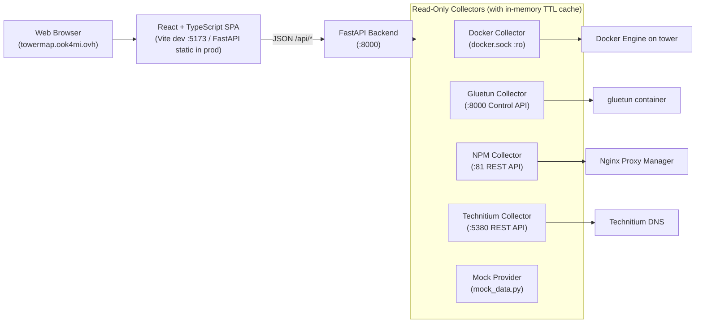

# TowerMap — Technical Specification

> **Purpose**: A lightweight, read-only self-hosted web app that maps every Docker stack, published host port, `gluetun` VPN dependency, and `*.ook4mi.ovh` route on `tower` (`192.168.68.62`).
>
> **Learning Goals**: Practice an end-to-end modern developer workflow using **VS Code**, **GitHub** (Issues, branches, Pull Requests, GitHub Actions CI/CD), **Docker**, and **AI-assisted development**.

---

## 1. Problem Statement & Goals

Managing ~20 Docker Compose stacks on `tower` introduces a few recurring friction points:
1. **Port collisions**: Before deploying a new stack, it is easy to forget which host ports are already bound (especially ports published indirectly on `gluetun`).
2. **Gluetun blast radius**: Over a dozen media acquisition containers share `network_mode: "service:gluetun"`. When `gluetun` restarts or loses VPN connectivity, attached containers silently lose network access until recreated.
3. **Route drift**: Mapping a domain (`service.ook4mi.ovh`) across **Technitium DNS** → **Nginx Proxy Manager** → **Docker container** currently requires checking three separate UIs.

### Goals (v1)
- Provide a single, fast, **read-only** dashboard for `tower`'s containers, ports, `gluetun` topology, and domain routes.
- Include an instant **"Is port X free?"** checker and next-available port suggester (defaulting to the `4010–4099` custom range).
- Support a **`MOCK_MODE=true`** mode so the app can be developed and tested locally on macOS without needing a live connection to `tower`.
- Degrade gracefully: if Nginx Proxy Manager, Technitium DNS, or Gluetun credentials are not configured, the Docker & Port views still work cleanly.

### Non-Goals (v1)
- No destructive or mutating actions (starting, stopping, restarting, or editing containers/DNS/proxy rules).
- No heavy time-series telemetry or replacement for Grafana/Prometheus.
- No multi-user auth system in v1 (intended for LAN / WireGuard / NPM-protected access).

---

## 2. Recommended Tech Stack

A clean, modern full-stack setup that pairs great with VS Code and AI pair-programming:

| Layer | Choice | Why |
| :--- | :--- | :--- |
| **Backend Language** | Python 3.12+ | Clean syntax, strong ecosystem, first-class Docker SDK. |
| **Backend API** | **FastAPI** + `uvicorn` | Automatic OpenAPI docs (`/docs`), Pydantic validation, async HTTP support. |
| **HTTP Client** | `httpx` (async) | Clean async calls to Gluetun, Nginx Proxy Manager, and Technitium DNS APIs. |
| **Docker Client** | `docker` (official Python SDK) | Native access to `/var/run/docker.sock` or SSH/TCP Docker host. |
| **Frontend** | **React + TypeScript + Vite** | Industry-standard typed UI stack with instant HMR in dev and fast static builds. |
| **Styling & UI** | **Tailwind CSS** + `lucide-react` | Utility-first styling with crisp icons and dark-mode homelab aesthetic. |
| **Data Fetching** | **TanStack Query** (`@tanstack/react-query`) | Built-in caching, loading/error states, auto-refetch, and manual refresh button support. |
| **Testing & Linting** | `pytest`, `ruff` (backend) · `tsc`, `eslint`, `vitest` (frontend) | Fast feedback in VS Code and GitHub Actions. |
| **Packaging & CI/CD** | Multi-stage **Docker** + **GitHub Actions** → GHCR (`ghcr.io`) | Single production container (FastAPI serves the built React app + `/api/*`). |

---

## 3. Architecture Overview



### Design Principles
- **Clean API boundary**: FastAPI exclusively serves typed JSON under `/api/*` (plus the built React static bundle in production). During local dev, Vite proxies `/api/*` to `http://localhost:8000` so there are no CORS issues.
- **Provider abstraction**: Each collector implements a simple interface and can be swapped with the mock provider when `MOCK_MODE=true`.
- **Short TTL cache** (e.g., 10–15 seconds, configurable via `CACHE_TTL_SECONDS`) + manual **"Refresh"** button so page loads feel instant without hammering APIs.
- **No secrets in code or Git**: All tokens/passwords are injected via environment variables (`.env` locally, Compose env on `tower`).

---

## 4. Data Sources & Integrations

### 4.1 Docker Engine (Required in Live Mode)
- **Source**: `/var/run/docker.sock` (mounted `:ro`) or `DOCKER_HOST` (e.g., `ssh://ook4mi@192.168.68.62` during local dev).
- **Fields extracted per container**:
  - `id` (short 12-char ID), `name`, `image`
  - `status` (`running`, `exited`, `restarting`, `created`), `health` (`healthy`, `unhealthy`, `starting`, `none`)
  - Compose labels:
    - `com.docker.compose.project` → stack name
    - `com.docker.compose.service` → service name
    - `com.docker.compose.project.config_files` → active compose file path
  - `NetworkSettings.Ports` → published host ports, protocols (`tcp`/`udp`), and container ports
  - `HostConfig.NetworkMode` → detects `container:<gluetun_full_id>` to identify VPN-attached containers

### 4.2 Gluetun Control Server (Optional — Milestone 2)
- **Base URL**: `GLUETUN_URL` (e.g., `http://192.168.68.62:8000`)
- **Endpoints**:
  - `GET /v1/vpn/status` → VPN tunnel state (`running` / `stopped`)
  - `GET /v1/publicip/ip` → current VPN public IP, country, region, organization
- **Health correlation**:
  - Cross-reference `gluetun`'s `StartedAt` timestamp and current container ID against every attached container's `HostConfig.NetworkMode`.
  - Flag a warning if an attached container references a stale/missing `gluetun` ID or is unhealthy.

### 4.3 Nginx Proxy Manager (Optional — Milestone 3)
- **Base URL**: `NPM_URL` (e.g., `http://192.168.68.62:81`)
- **Auth**: `POST /api/tokens` with `NPM_IDENTITY` + `NPM_SECRET` (JWT cached in memory and refreshed on expiry).
- **Endpoint**: `GET /api/nginx/proxy-hosts`
- **Fields extracted**: `domain_names`, `forward_scheme`, `forward_host`, `forward_port`, `certificate_id` (SSL enabled), `enabled`.

### 4.4 Technitium DNS (Optional — Milestone 3)
- **Base URL**: `TECHNITIUM_URL` (e.g., `http://192.168.68.62:5380`)
- **Auth**: API Token (`TECHNITIUM_API_TOKEN`)
- **Endpoint**: `GET /api/zones/records/get?token=<token>&domain=ook4mi.ovh&listZone=true`
- **Fields extracted**: `A`, `AAAA`, and `CNAME` records under `ook4mi.ovh`.

---

## 5. Core Data Models (Pydantic)

```python
class PortBinding(BaseModel):
    host_ip: str = "0.0.0.0"
    host_port: int
    container_port: int
    protocol: str  # "tcp" | "udp"
    container_name: str
    stack_name: str | None = None
    via_gluetun: bool = False

class ContainerInfo(BaseModel):
    id: str
    name: str
    image: str
    stack_name: str | None = None
    compose_file: str | None = None
    state: str            # running, exited, created, ...
    health: str | None = None
    started_at: str | None = None
    network_mode: str
    gluetun_attached: bool = False
    ports: list[PortBinding] = []

class GluetunOverview(BaseModel):
    container_state: str
    vpn_status: str | None = None
    public_ip: str | None = None
    country: str | None = None
    attached_containers: list[ContainerInfo] = []
    warnings: list[str] = []

class RouteEntry(BaseModel):
    domain: str
    dns_record_type: str | None = None
    dns_target: str | None = None
    proxy_enabled: bool | None = None
    proxy_target: str | None = None      # e.g., "192.168.68.62:8989"
    ssl_enabled: bool = False
    matched_container: str | None = None
    status: str  # "ok" | "orphan_dns" | "orphan_proxy" | "target_down" | "external"
```

---

## 6. API Design

All JSON endpoints live under `/api/` and return typed Pydantic models:

| Method | Path | Description |
| :--- | :--- | :--- |
| `GET` | `/api/health` | App liveness check (`{"status": "ok", "mode": "mock|live"}`). |
| `GET` | `/api/overview` | Summary counters (stacks, running/stopped containers, used ports, active alerts). |
| `GET` | `/api/containers` | List all containers. Query params: `?stack=`, `?state=`, `?gluetun_only=true`, `?q=`. |
| `GET` | `/api/ports` | Sorted list of all bound host ports. Query params: `?protocol=tcp\|udp`, `?q=`. |
| `GET` | `/api/ports/check` | Check availability for `?port=4010` and return next free port in `4010–4099`. |
| `GET` | `/api/gluetun` | Gluetun container status, VPN IP/country, attached containers, and warnings. |
| `GET` | `/api/routes` | Correlated `*.ook4mi.ovh` DNS → NPM → Container route table. |
| `POST` | `/api/cache/refresh` | Bust in-memory cache and re-fetch live data. |

### Web UI Architecture (React + TypeScript)
Single-page app built with Vite, styled with Tailwind CSS, consuming `/api/*` via a typed `api/client.ts` + TanStack Query hooks:
- **Top Summary Bar**: Total Stacks, Running/Stopped containers, live Gluetun VPN status pill (IP + country), Route Alerts badge, Mock/Live mode indicator, and a manual **Refresh** button (`POST /api/cache/refresh`).
- **Views / Tabs**:
  1. **Stacks & Containers** — Grouped by Compose project, instant client-side search & status filter, health badges, and compose file path tooltip.
  2. **Port Registry** — Sortable table of bound host ports (with `via gluetun` badge) + interactive **"Check Port / Suggest Next Free"** widget calling `/api/ports/check`.
  3. **Gluetun Topology** — VPN status banner (IP, country, health) + visual list/graph of all containers sharing `gluetun`'s network namespace and their published ports.
  4. **Routes (`*.ook4mi.ovh`)** — Unified Domain → Technitium DNS → NPM → Docker container table with color-coded drift badges (`OK`, `Target Down`, `Orphan Proxy`, `DNS Only`).
- **Dev vs. Prod Serving**:
  - **Local dev**: Run FastAPI on `:8000` and Vite on `:5173` (with `vite.config.ts` proxying `/api` → `http://localhost:8000`).
  - **Production container**: FastAPI mounts the compiled `frontend/dist` bundle and serves `index.html` for non-`/api` routes, keeping deployment to a single lightweight Docker container.

---

## 7. Configuration & Environment Variables

Provide a committed `.env.example` (never commit `.env`):

```dotenv
# General
APP_ENV=development
MOCK_MODE=true
CACHE_TTL_SECONDS=15
DEFAULT_DOMAIN=ook4mi.ovh
SUGGEST_PORT_START=4010
SUGGEST_PORT_END=4099

# Docker (used when MOCK_MODE=false)
# Leave empty to use local /var/run/docker.sock
DOCKER_HOST=

# Gluetun (optional)
GLUETUN_URL=http://192.168.68.62:8000
GLUETUN_API_KEY=

# Nginx Proxy Manager (optional)
NPM_URL=http://192.168.68.62:81
NPM_IDENTITY=
NPM_SECRET=

# Technitium DNS (optional)
TECHNITIUM_URL=http://192.168.68.62:5380
TECHNITIUM_API_TOKEN=
```

---

## 8. Repository Structure

```text
towermap/
├── .github/
│   └── workflows/
│       └── ci.yml                  # Backend (ruff/pytest) + Frontend (tsc/eslint/build) + GHCR image
├── backend/
│   ├── app/
│   │   ├── __init__.py
│   │   ├── main.py                 # FastAPI entrypoint, /api router, static SPA serving in prod
│   │   ├── config.py               # Pydantic Settings (loads .env)
│   │   ├── models.py               # Pydantic data models
│   │   ├── cache.py                # Simple TTL cache
│   │   ├── collectors/
│   │   │   ├── docker_collector.py
│   │   │   ├── gluetun_collector.py
│   │   │   ├── npm_collector.py
│   │   │   ├── dns_collector.py
│   │   │   └── mock_data.py        # Realistic tower snapshot for offline Mac dev
│   │   ├── services/
│   │   │   ├── port_service.py     # Port conflict check & next-free-port logic
│   │   │   └── route_service.py    # Correlates DNS + NPM + Docker
│   │   └── routers/
│   │       └── api.py              # /api/* JSON endpoints
│   ├── tests/
│   │   ├── test_api.py
│   │   ├── test_port_service.py
│   │   └── test_route_service.py
│   └── pyproject.toml
├── frontend/
│   ├── src/
│   │   ├── api/
│   │   │   ├── client.ts           # Typed fetch wrapper for /api/*
│   │   │   └── types.ts            # TypeScript interfaces matching Pydantic models
│   │   ├── hooks/
│   │   │   └── useTowerMap.ts      # TanStack Query hooks (overview, containers, ports, gluetun, routes)
│   │   ├── components/
│   │   │   ├── HeaderBar.tsx       # Summary stats, Gluetun status pill, Refresh button
│   │   │   ├── ContainersView.tsx  # Grouped Compose stacks + search/filter
│   │   │   ├── PortsView.tsx       # Port registry table + "Check Port" widget
│   │   │   ├── GluetunView.tsx     # VPN status card + attached containers topology
│   │   │   └── RoutesView.tsx      # *.ook4mi.ovh DNS -> NPM -> Container table
│   │   ├── App.tsx
│   │   ├── main.tsx
│   │   └── index.css               # Tailwind CSS entrypoint
│   ├── index.html
│   ├── package.json
│   ├── tsconfig.json
│   └── vite.config.ts              # Dev proxy: /api -> http://localhost:8000
├── .env.example
├── .gitignore
├── Dockerfile                      # Multi-stage: Stage 1 builds React (node), Stage 2 runs FastAPI (python)
├── compose.yaml                    # Production reference compose file for tower
├── README.md
└── SPEC.md
```

---

## 9. Milestones & GitHub Workflow Plan

Create one GitHub Issue per milestone and develop each on a dedicated feature branch (e.g., `feat/m1-docker-ports`) merged via Pull Request.

### Milestone 1 — Foundation, Mock Mode & Port Registry (MVP)
- [ ] Scaffold `backend/` (`pyproject.toml`, FastAPI app, `ruff`, `pytest`) and `frontend/` (Vite + React + TypeScript + Tailwind + TanStack Query, with `/api` dev proxy).
- [ ] Implement `mock_data.py` modeled after `tower`'s stacks so both backend and frontend work offline on macOS.
- [ ] Implement `docker_collector.py` (reads real Docker engine when `MOCK_MODE=false`).
- [ ] Implement `/api/overview`, `/api/containers`, `/api/ports`, `/api/ports/check`.
- [ ] Build typed TypeScript API client + **HeaderBar**, **ContainersView**, and **PortsView** (including the interactive free-port checker).
- [ ] Add backend unit tests (`pytest`) for port parsing and conflict checking.

### Milestone 2 — Gluetun VPN & Dependency Inspector
- [ ] Detect `network_mode` referencing `gluetun` and tag attached containers/ports.
- [ ] Implement `gluetun_collector.py` (`/v1/vpn/status`, `/v1/publicip/ip`).
- [ ] Add `/api/gluetun` and build the **GluetunView** React tab + top-bar VPN status pill with warning banners.
- [ ] Add unit tests for Gluetun correlation and error handling (when Gluetun is unreachable).

### Milestone 3 — Domain & Route Mapping (`*.ook4mi.ovh`)
- [ ] Implement `npm_collector.py` and `dns_collector.py` (both optional and fault-tolerant).
- [ ] Implement `route_service.py` to match DNS → NPM → Docker container by target host/port.
- [ ] Add `/api/routes` and build the **RoutesView** React tab highlighting `OK`, `Orphan Proxy`, `DNS Only`, and `Target Down`.
- [ ] Add unit tests covering all route status edge cases.

### Milestone 4 — Containerization, CI/CD & Deployment on `tower`
- [ ] Write a multi-stage `Dockerfile` (`node:22-alpine` builds `frontend/dist`, `python:3.12-slim` runs FastAPI serving both `/api/*` and the static React SPA).
- [ ] Add `.github/workflows/ci.yml`:
  - On PR: backend job (`ruff check`, `pytest`) + frontend job (`tsc --noEmit`, `npm run lint`, `npm run build`).
  - On push to `main`: build and push `ghcr.io/<github-user>/towermap:latest`.
- [ ] Deploy on `tower` at `/home/ook4mi/docker/towermap/compose.yaml`.
- [ ] Add DNS record in Technitium + reverse proxy host in NPM for `towermap.ook4mi.ovh`.

---

## 10. Target Deployment on `tower`

Follows `tower`'s established Docker conventions (`/home/ook4mi/docker/towermap/compose.yaml`):

```yaml
services:
  towermap:
    image: ghcr.io/<your-github-username>/towermap:latest
    container_name: towermap
    restart: unless-stopped
    ports:
      - "4010:8000"
    environment:
      - TZ=Europe/Paris
      - MOCK_MODE=false
      - DEFAULT_DOMAIN=ook4mi.ovh
      - GLUETUN_URL=http://192.168.68.62:8000
      - NPM_URL=http://192.168.68.62:81
      - TECHNITIUM_URL=http://192.168.68.62:5380
    env_file:
      - /home/ook4mi/appdata/towermap/.env
    volumes:
      - /var/run/docker.sock:/var/run/docker.sock:ro
      - /etc/localtime:/etc/localtime:ro
```

> **Security Hardening Note (Stretch Goal)**: Even mounted `:ro`, direct access to `/var/run/docker.sock` grants broad Docker API read access. Once v1 is working, a great follow-up milestone is placing a read-only `tecnativa/docker-socket-proxy` sidecar (`CONTAINERS=1`, everything else `0`) in the same compose stack and pointing `DOCKER_HOST=tcp://socket-proxy:2375` at it.
